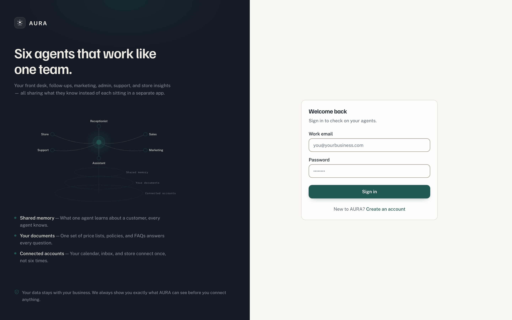
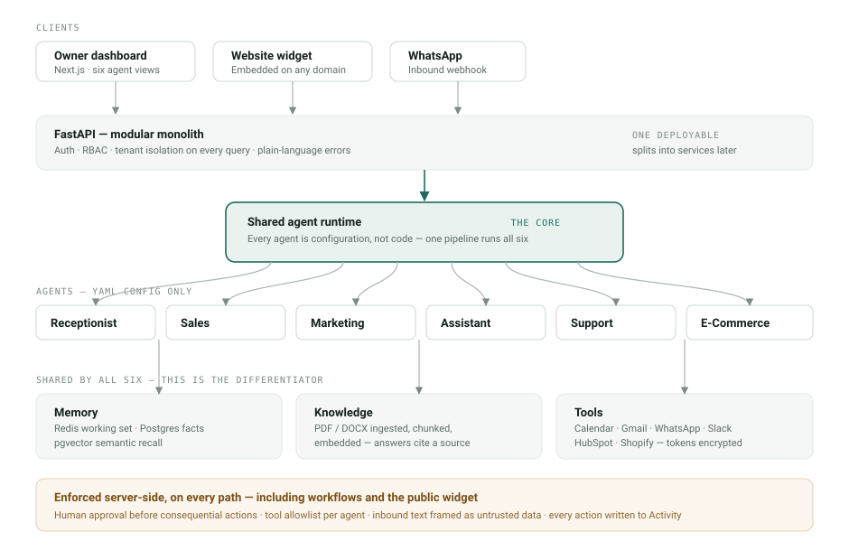
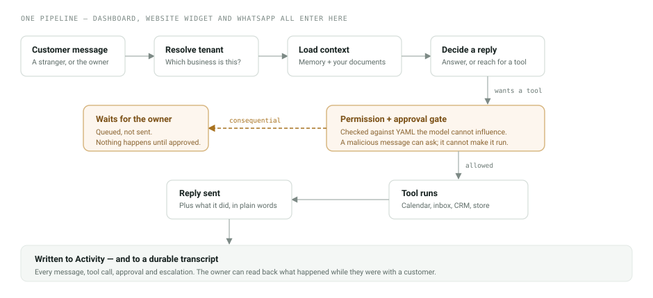
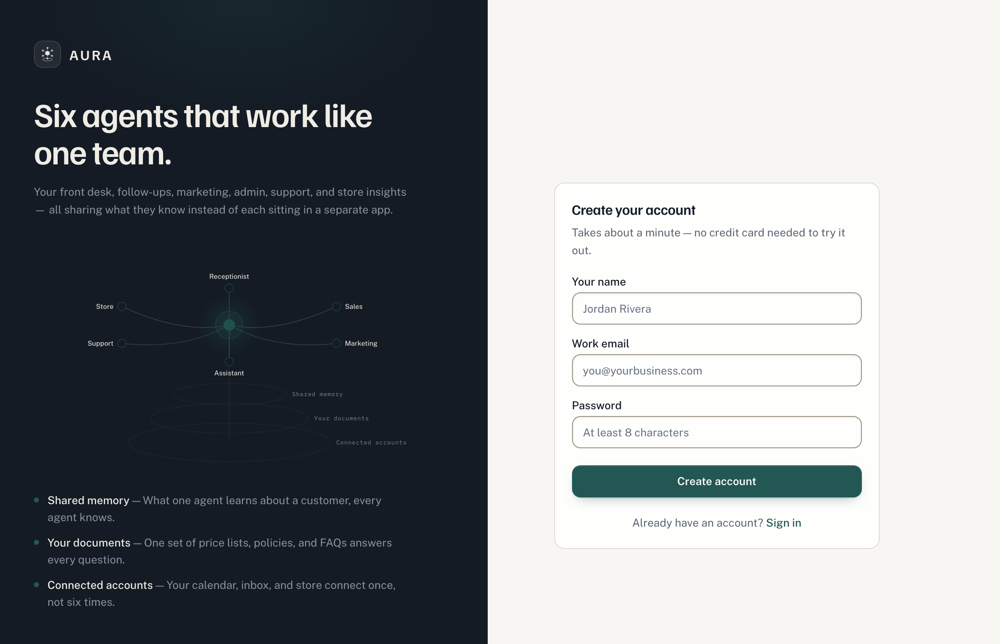

<div align="center">

<br/>

# ◎ &nbsp; M E S N I U M

### Six AI agents that work like one team — not six chatbots in six tabs.

A multi-tenant **AI business operating system** for small businesses:<br/>clinics, salons, trades, agencies and small e-commerce brands.

<br/>


<br/>

<table>
<tr>
<td align="center"><strong>215</strong><br/><sub>backend tests</sub></td>
<td align="center"><strong>7</strong><br/><sub>agents</sub></td>
<td align="center"><strong>4</strong><br/><sub>industry packs</sub></td>
<td align="center"><strong>49</strong><br/><sub>API operations</sub></td>
<td align="center"><strong>7</strong><br/><sub>migrations</sub></td>
<td align="center"><strong>14</strong><br/><sub>eval scenarios</sub></td>
</tr>
</table>

<br/>



<sub>The screenshots in this README predate the rename and still show the old product name, AURA.</sub>

</div>

<br/>

---

## The problem

A small clinic's leads arrive as **messages** — a WhatsApp at 9pm, an Instagram DM on Sunday, a web form nobody checks until Tuesday. Industry response time averages hours; a lead answered within five minutes converts several times better.

Meanwhile the tools that promise to help arrive as six separate subscriptions that each know nothing about the others.

> Mesnium answers on those channels, books into the calendar, and keeps working the relationship afterwards — with the owner able to **see and approve** everything consequential before it happens.

<br/>

## Why it isn't six chatbots

The differentiator isn't "we have AI agents." It's that they all run on **one runtime, one memory, and one set of connected accounts**.

|  |  |
|---|---|
| 🧠 | What the Receptionist learns about a customer, the Assistant already knows |
| 📄 | Your price list is uploaded **once** and answers every question |
| 🔌 | Your calendar connects **once**, not six times |
| 🏷️ | What the business *is* — its hours, services, tone and rules — is written **once** and shapes every agent |

An agent here is **configuration, not code** — a prompt, a memory scope, a tool allowlist and an approval policy in a YAML file. Adding another is a config file, not a new service. There are six specialists (Receptionist, Sales, Marketing, Executive Assistant, Support, E-Commerce) and a seventh, the **Chief of Staff**, which takes one request in plain language and delegates to the right specialist.

<br/>



<br/>

## 🔒 The part that matters most: it can't act behind your back

Every consequential action is gated **server-side**, against configuration the model cannot influence. A malicious document, a hostile WhatsApp message, or the model itself can *ask* to cancel an appointment.

**None of them can make it happen.**

<br/>



<br/>

This holds on every path — the dashboard, the public website widget, inside autonomous workflows, and when the Chief of Staff delegates. Delegation is just another tool call that re-enters the same runtime, so a delegated specialist is checked, gated and audited exactly as if the owner had spoken to it directly. There is a test literally named `test_a_workflow_cannot_bypass_the_approval_gate`, because that is exactly the hole worth worrying about.

| Guarantee | How it's enforced |
|:---|:---|
| **Human approval** before consequential actions | Server-side against YAML, re-checked at approve time so a stale approval can't be replayed |
| **Tenant isolation** | Every org-scoped query filtered by organization; membership verified on every request |
| **Untrusted input** | Documents, tool results and customer messages are delimited and framed as data, never instructions |
| **Tool allowlist** per agent | An agent cannot call a tool outside its config, even if the model asks |
| **Packs can only add** | An industry pack can extend an agent's prompt, tools and approval rules — it can never remove or loosen what the base agent has, and workflow steps obey the pack-merged rules too |
| **Encrypted at rest** | Integration tokens use Fernet; production refuses to boot without a key |
| **Safe connecting** | A pasted key is verified against the other app before it is saved; a Shopify store address or WhatsApp number is validated against a strict pattern *before* any request is made |
| **Untrusted replies, rendered safely** | The website widget never treats an AI reply as HTML — only fixed formatting elements are created, and links stay plain text |
| **Full audit trail** | Every message, tool call, approval and escalation written to Activity, in plain language |

<br/>

## What's built

### 🤖 Seven agents
Receptionist · Sales · Marketing · Executive Assistant · Support · E-Commerce, plus the **Chief of Staff** orchestrator, which delegates one request to the right specialist (or several) and reports back honestly — including anything still waiting on the owner's approval.

### 🏷️ Business context
Each business fills in who it is once — identity and hours, offerings and prices, customers, brand voice, policies, operating procedures and contacts. A compact, role-tailored summary is added to every agent's prompt (the Receptionist gets services and policies; Sales gets qualification criteria; Marketing gets brand voice), so answers come from *this* business's facts instead of a generic guess. Edited under **Settings → Business**.

### 📦 Industry packs
A pack is **configuration, not code** — a YAML file that tunes the same agents for one kind of business. Activate one under **Settings → Packs**; no billing yet.

| Pack | What it adds |
|:---|:---|
| **Dental practice** | Urgent-symptom triage first, never diagnoses or quotes clinical advice, never confirms insurance or prices. Workflows: urgent-symptom alert, six-month check-up reminders |
| **Salon, spa & barber** | Booking by service and stylist, patch-test and allergy care, no promised results. Workflows: reaction-and-burn alert, time-to-rebook reminders |
| **Home services** (trades) | Emergency safety guidance for gas, electric, water and CO without DIY repair advice, honest quotes and arrival windows, no unverified registration claims. Workflows: emergency call-out alert, annual-service reminders |
| **Real estate** | Buyer intake, Fair-Housing-aware marketing, showings gated behind approval. Workflow: buyer-enquiry follow-up |

Each pack gives the Receptionist, Sales, Marketing and Executive Assistant their own guidance (the first three packs also tune Support). Activating a pack **installs its workflows switched off** — turning one on is the owner's decision. A pack that names an agent that doesn't exist, or a workflow the engine can't run, **fails when it loads**, not on a customer's first message.

> The prompts for emergencies and safety (gas, reactions, burns, clinical limits) deserve review by someone from that trade before a real customer relies on them.

### ⚙️ Workflow engine
Definitions live in the database; triggers are scheduled or event-based; steps **suspend and resume**, so a multi-day sequence survives a restart. Every workflow step goes through the same approval gate as a chat.

- **Standard templates:** appointment reminder → no-show recovery → rebook offer, treatment recall, and new-enquiry escalation.
- **Pack workflows** install per business on activation (seven today).
- **Run a test:** every workflow card has a "Run a test" button that runs the real engine once — even while switched off — with an optional pretend customer message. Anything that would message a patient still waits for approval.
- **Alerts that need no AI:** the urgent-symptom, reaction and emergency alerts match keywords, so they still fire if the AI provider is down.

### 🔌 Integrations

| App | How it connects | Status |
|:---|:---|:---|
| **Google Calendar & Gmail** | Real "Sign in with Google" consent flow — a signed, single-use state token ties the redirect to the right business | Built; needs your Google Cloud OAuth client |
| **WhatsApp Business** | Paste a phone number ID and token on the Connect screen | Built and unit-tested; **never connected to a real account yet** |
| **Slack** | Paste a bot token | Same |
| **HubSpot** | Paste a private-app token | Same |
| **Shopify** | Paste a store address and Admin API token (read-only use) | Same |

Pasted keys are checked against the other app before saving (a wrong key is explained on the form and nothing is stored), kept encrypted, and never shown again. Only owners and admins can connect or disconnect, and disconnecting Google also asks Google to revoke the grant.

### 🧠 AI providers
The AI gateway is provider-agnostic. Choose **OpenAI** or **Gemini** with `AI_PROVIDER`; both normalise into the same response shape, so nothing above the gateway cares which is active. Transient failures retry with backoff; if a provider is out of quota or down, users get a plain "temporarily unavailable" message rather than a stack trace.

### 📥 Channels
Owner dashboard · embeddable website chat widget · WhatsApp webhook.

### 📚 Knowledge, 📊 Results & Activity
PDF and DOCX ingested, chunked and embedded into **pgvector** — answers cite the document they came from. A dashboard leads with recovered revenue and a plain-language feed of what agents did. Owners can step into any conversation and take over from the agent.

<br/>



<br/>

## 🚀 Quick start

> Requires Python 3.11, Node 20, and Docker (for PostgreSQL with `pgvector`, and Redis).

```bash
# 1 — Services (Postgres + pgvector, Redis)
docker compose -f infra/docker-compose.yml up -d postgres redis

# 2 — Backend
cd apps/api
python -m venv .venv && source .venv/bin/activate
pip install -e ".[dev]"
cp .env.example .env          # fill in what you have — see Configuration
python -m alembic upgrade head
python -m uvicorn src.main:app --reload --port 8000

# 3 — Frontend (new terminal)
cd apps/web
cp .env.local.example .env.local
npm install && npm run dev
```

Open <http://localhost:3000>, sign up, and create your business. A real signup starts with an **empty** business — nothing is pre-filled.

To look at a populated product instead, seed the demo:

```bash
cd apps/api && python -m scripts.seed_demo
```

This creates **Riverside Dental**, a *fictional* clinic used only for demos: an owner login, five patients, three ingested documents, 24 conversations, three enabled workflows with run history, and one action waiting for approval. It prints the login details and is safe to re-run. Nothing in the product depends on it.

<br/>

### 🔑 An AI key is needed for chat

The Receptionist, the website widget and every other agent chat go through the AI provider, so they need one key:

- `AI_PROVIDER=gemini` with `GEMINI_API_KEY` — has a free tier, but it is small (about 20 requests a day on current models), fine for trying it out and far too little for real traffic.
- `AI_PROVIDER=openai` with `OPENAI_API_KEY`.

Without a key, chat returns a clear "not set up yet" message; everything else (connecting apps, packs, workflows, the dashboard) still works. The demo seed ingests its documents for real and substitutes a deterministic stand-in for the embedding call when no key is set.

<br/>

## 🔗 Connecting Google

1. In Google Cloud Console, enable the Calendar and Gmail APIs and create an OAuth client of type **Web application**.
2. Add `http://localhost:8000/api/v1/integrations/google/callback` as an authorised redirect URI, and add yourself as a test user on the consent screen.
3. Set `GOOGLE_OAUTH_CLIENT_ID` and `GOOGLE_OAUTH_CLIENT_SECRET` in `apps/api/.env`, restart the API, then **Settings → Integrations → Connect**.

While the consent screen is in *Testing* mode Google shows an "unverified app" warning and expires refresh tokens after 7 days; real customers need Google's app verification.

<br/>

## 💬 Adding the chat widget to a website

One tag, pasted once, on any domain:

```html
<script src="https://your-mesnium-host/widget.js"
        data-org="YOUR_PUBLIC_ID"
        data-api="https://your-mesnium-api-host"></script>
```

Dependency-free and rendered in a **closed shadow DOM**, so it can't leak styles into or out of the host page. Visitors talk to the same AI Receptionist the owner sees, grounded in the business's own details and any active pack; replies render bold, italics and bullet lists. **Settings → Integrations** shows the tag with the real id filled in, a live preview, and an on/off switch. It is the product's only unauthenticated surface, so it is rate-limited per visitor and per conversation.

<br/>

## 📁 Project layout

```
apps/
  api/                     FastAPI modular monolith
    src/
      identity/            Auth, organizations, RBAC, tenant isolation
      agents/
        runtime/           The shared pipeline every agent executes through,
                           plus pack merging and business-context projection
        configs/           Seven YAML agents — prompt, tools, approval policy
        packs/             Industry packs — dental, salon, home services, real estate
        scripted/          Old predefined menu flow — unused, listed for removal
      ai_gateway/          Provider-agnostic LLM + embeddings (OpenAI, Gemini)
      workflows/           Engine, stored definitions, scheduled runner
      memory/              Redis working set · Postgres facts · pgvector
      knowledge/           Ingestion, chunking, embedding, search
      tools/               Calendar, Gmail, WhatsApp, Slack, HubSpot, Shopify,
                           delegate (orchestrator), Google OAuth, key verification
      conversations/       Durable transcripts, contacts, human takeover
      evals/               14 scenarios incl. refusal and blocked-tool cases
      api/v1/              49 operations
  web/                     Next.js 14 dashboard + embeddable widget
docs/                      Customer profile, scope ledger, open decisions
infra/                     docker-compose for local Postgres and Redis
```

<br/>

## 🧪 Testing

```bash
cd apps/api && python -m pytest            # 215 tests
cd apps/web && npm run lint && npm run build
```

Tests run on SQLite with a fake Redis, so **no services are required** locally. CI runs the whole suite — and the migration chain — against real PostgreSQL and Redis, because pgvector operators and event-loop behaviour are Postgres-only and SQLite hides that entire class of failure.

<br/>

## ⚙️ Configuration

Everything lives in `apps/api/.env.example`. The essentials:

| Variable | Notes |
|:---|:---|
| `DATABASE_URL`, `REDIS_URL` | Required |
| `JWT_SECRET` | Required — production refuses to boot with the dev default |
| `ENCRYPTION_KEY` | Fernet key for integration tokens; production refuses to boot without it. **Back it up** — lose it and every stored connection becomes unreadable (there is no rotation path yet) |
| `AI_PROVIDER` | `openai` or `gemini` — see "An AI key is needed for chat" |
| `OPENAI_API_KEY` / `GEMINI_API_KEY` | One for whichever provider you chose |
| `GOOGLE_OAUTH_CLIENT_ID` / `_SECRET` / `GOOGLE_OAUTH_REDIRECT_URI` | For the Google sign-in flow |
| `APP_URL` | Dashboard address, used in links and the Google redirect back |
| `WHATSAPP_VERIFY_TOKEN`, `WHATSAPP_APP_SECRET` | Only for the inbound WhatsApp webhook |

WhatsApp, Slack, HubSpot and Shopify credentials are **not** environment variables: each business pastes its own on the Connect screen. A tool without its credential returns a clean *"not connected yet"* instead of failing.

<br/>

## 📌 Honest status

This is an **MVP that has not been deployed**, and the repo is deliberately candid about where the edges are:

- **[`docs/needs-founder-input.md`](docs/needs-founder-input.md)** — every item blocked on a credential, an account or a business decision, with exactly what's needed and why.
- **[`docs/scope-ledger.md`](docs/scope-ledger.md)** — every deviation from the original plan in *both* directions.

**Known and documented:**

- **Not deployed.** It runs locally. A production setup (managed Postgres with backups, an always-on API, HTTPS, a web Dockerfile, migrations on deploy) is not built; the compose file is for development.
- **No desktop app yet.** The dashboard is a browser app. A packaged desktop shell is planned, not started.
- **Four connections have only been tested against stand-ins:** WhatsApp, Slack, HubSpot and Shopify have never been connected to a real account — only to test doubles and to the apps' own rejection of made-up keys. Expect one round of small fixes when real credentials arrive.
- **Google's consent flow needs your own Google Cloud client**, and stays in "unverified app" mode until Google verifies it.
- **Packs are prompts, not products.** No billing or checkout; safety-critical wording hasn't been reviewed by industry experts.
- **Free AI tier is too small for production** — see above.
- **Approval notifications log to the console** until an email provider key is set.
- **Gaps in reach:** no telephony; Google Calendar only, no practice-management-system integration; no Microsoft 365 or LinkedIn; no automated tests for the website widget's JavaScript.
- **Leftovers:** the unused scripted-chat code is still in the tree, and the screenshots above show the old name.

**Lineage.** The business-context and pack design follows an earlier Mesnium prototype built inside a separate, OpenClaw-based assistant repo. This codebase is an independent rebuild — only the concepts were ported, and a good deal of that prototype (an automation studio, voice, richer approvals) has not been.

<br/>

---

<div align="center">
<sub>Built as a <strong>modular monolith</strong> on purpose — every module is independently testable<br/>and splits into a service later without changing its boundaries.</sub>
</div>
